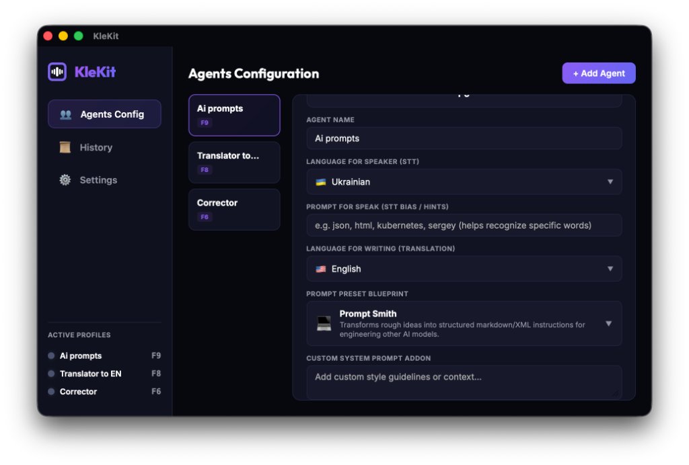

# KleKit 🎙️

> **Offline, privacy-first voice dictation and text refinement assistant exclusively for macOS (Apple Silicon)**

KleKit lets you dictate text using your voice or refine selected text on your machine — no internet, no cloud, no data leaving your device. Press a hotkey, speak/select, and the processed text is pasted instantly wherever your cursor is.



---

## ✨ Features

- 🎙️ **Voice Dictation** — Record voice input with a global hotkey, transcribe offline via Whisper STT, and paste the transcription directly at your cursor.
- ✍️ **Text Refinement & Agents** — Highlight any text in any app, trigger a custom Agent hotkey, and have Gemma automatically refine, edit, format, or translate it in place.
- 🔒 **100% Offline** — All processing happens locally on-device, ensuring complete privacy.
- ⚡ **macOS Native & Accelerated** — Dynamic compilation and execution tailored to Apple Silicon (Metal/XNNPACK) on macOS.
- 🧠 **Smart Gemma 4 Refiner** — Google AI Edge **Gemma 4 E4B** model can fix text, translate, format business messages, structure speech, or create AI-agent prompts.
- 🧩 **Five Prompt Presets** — Every agent configuration can use **No Preset**, **Fix Text**, **Business Style**, **Structured Text**, or **Create Prompt**; a Custom Prompt remains available for extra instructions.
- ⏱️ **Bounded Recording** — Choose a maximum recording length from 1 to 10 minutes in Settings to keep memory use predictable.
- 📜 **Optional Local History** — Keep voice history on-device, disable it entirely, or set automatic retention in days.
- 🎯 **Works Anywhere** — Emulates keystrokes to paste text into any active input field (IDE, browser, Slack, Notes…).
- 💤 **Zero Idle RAM** — Models automatically unload after 60 seconds of inactivity to keep a tiny memory footprint (~20-30 MB).

---

## 🏗️ Architecture

KleKit operates via two distinct pipelines:

1. **Voice Dictation (Whisper STT):**
```
Voice Hotkey (hold) ──> cpal Audio Recorder ──> whisper-rs STT (GGML) ──> (Optional Gemma 4 LLM) ──> OS Paste Inject
```

2. **Selected Text Refinement (Gemma LLM Agents):**
```
Agent Hotkey ──> OS Copy (Cmd+C) ──> Gemma 4 LLM (LiteRT-LM) ──> OS Paste Inject (Cmd+V)
```

| Module | Technology / Implementation | Role |
|---|---|---|
| Audio capture | `cpal` (see [src/audio.rs](src/audio.rs)) | 16 kHz mono PCM from mic |
| Speech-to-text | `whisper-rs` (whisper.cpp) | Offline transcription |
| Text refinement | [llm_refiner.rs](src/bin/llm_refiner.rs) (`litert-lm` CLI / Gemma 4 E4B) | Preset-driven text transformation |
| OS integration | [src/os_integration.rs](src/os_integration.rs) (`arboard` + CoreGraphics) | Hotkey & clipboard paste |
| App shell | `Tauri 2` (see [src-tauri/Cargo.toml](src-tauri/Cargo.toml)) | Menu-bar tray app |

The core coordinator for this workflow is the [VoiceAssistantEngine](src/lib.rs) struct.

### 🍏 New macOS Inference Engine
Unlike the old GGUF-based inference, KleKit now utilizes Google's official **AI Edge LiteRT-LM** engine. 
- The Rust sidecar dynamically locates the `litert-lm` command-line tool within your system `PATH`, with a fallback for macOS Python environments (`~/Library/Python/3.14/bin/litert-lm`).
- It executes the official Gemma 4 E4B model in `.litertlm` format.
- The sidecar uses Gemma 4 chat turns and is rebuilt automatically in development when its source changes.

---

## 📋 Requirements

- **macOS** 11.0+ (Apple Silicon M1/M2/M3/M4 recommended)
- [Rust](https://rustup.rs/) 1.77+
- [Tauri CLI](https://tauri.app/start/prerequisites/) v2
- **Google AI Edge `litert-lm` CLI tool** (must be installed globally or at `~/Library/Python/3.14/bin/litert-lm` on macOS).
- Model files (stored locally, **not** included in this repo):
  - `models/ggml-large-v3-turbo.bin` — full Whisper large-v3-turbo model ([download](https://huggingface.co/ggerganov/whisper.cpp))
  - `models/gemma-4-E4B-it.litertlm` — Gemma 4 E4B official Google AI Edge model

---

## 🚀 Getting Started

### 1. Clone the repo
```bash
git clone https://github.com/mo0rych0k/klekit-mac.git
cd klekit-mac
```

### 2. Download models
```bash
mkdir -p models

# Full Whisper large-v3-turbo (~1.5 GB)
curl -L https://huggingface.co/ggerganov/whisper.cpp/resolve/main/ggml-large-v3-turbo.bin \
  -o models/ggml-large-v3-turbo.bin

# Place the official gemma-4-E4B-it.litertlm model in your models directory
# (Download gemma-4-E4B-it.litertlm from Hugging Face's LiteRT community repository)
```

### 3. Build and run
```bash
cargo tauri dev
```

### 4. Grant permissions
On first launch, the OS will prompt for:
- **Microphone** — for audio capture
- **Accessibility / Input Monitoring** — for global hotkey and clipboard/paste emulation (see [os_integration.rs](src/os_integration.rs))

---

## ⚙️ Configuration

Settings are stored in `~/Library/Application Support/klekit/config.json` on macOS. They are managed by [AppSettings](src/settings.rs) and [AgentProfile](src/settings.rs):

```json
{
  "enable_auto_paste": true,
  "enable_sounds": true,
  "enable_gemma": false,
  "voice_hotkey_type": "Keyboard",
  "voice_hotkey_value": "",
  "voice_stt_language": "auto",
  "voice_whisper_prompt": "",
  "voice_max_recording_minutes": 2,
  "save_history": true,
  "history_retention_days": 0,
  "agents": []
}
```

`history_retention_days: 0` keeps history until it is manually cleared. For each agent, choose an output language; selecting `English` makes the final refinement/translation English. With **No Preset**, an empty Custom Prompt leaves the text unchanged.

The system prompt presets and vocabulary defaults are loaded from the [resources/](resources/) folder:
- **Voice Recognition Hints**: [prompt_for_speak.txt](resources/prompt_for_speak.txt) is a plain-text list of technical keywords used as Whisper's initial prompt.
- **LLM Refiner Presets**: [gemma_prompts.json](resources/gemma_prompts.json) contains the Gemma 4 base prompt and agent templates.

---

## 🧠 Memory Management

KleKit utilizes a "Zero-Memory Idle" state:

| State | Memory usage |
|---|---|
| Idle (models unloaded) | ~20–30 MB |
| Transcribing (Whisper loaded) | ~500 MB |
| Refining (Gemma 4 running via LiteRT) | ~2–3 GB (during inference only) |

Whisper is automatically unloaded after **60 seconds** of inactivity. Gemma runs only for the lifetime of its `litert-lm` subprocess.

---

## 🛠️ Development

```bash
# Run with hot-reload
cargo tauri dev

# Build release bundle
cargo tauri build

# Run tests
cargo test
```

---

## 📄 License

MIT © [mo0rych0k](https://github.com/mo0rych0k) - [MIT License Terms](https://opensource.org/licenses/MIT)
